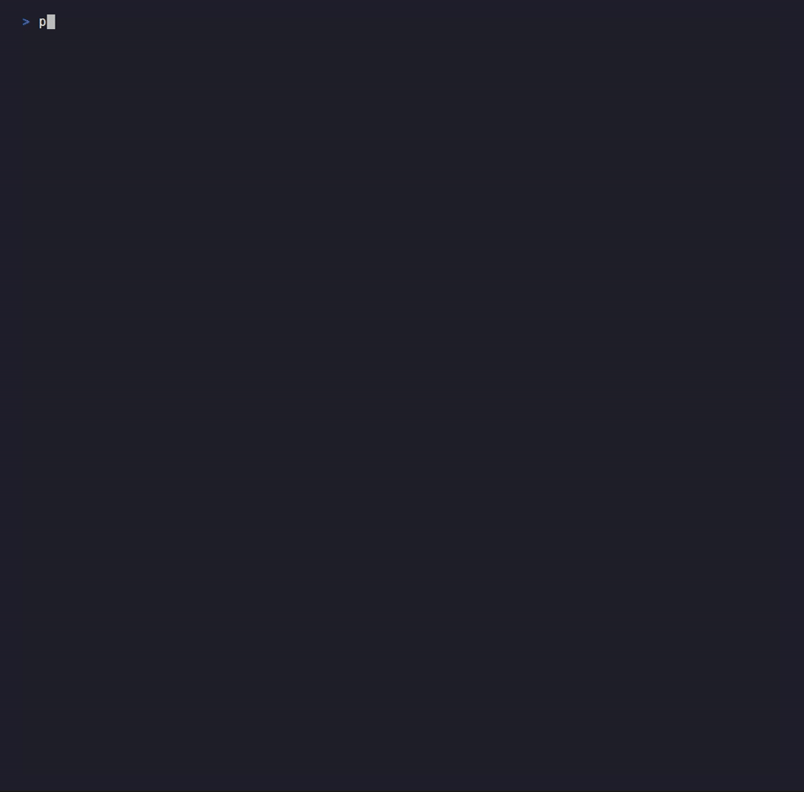
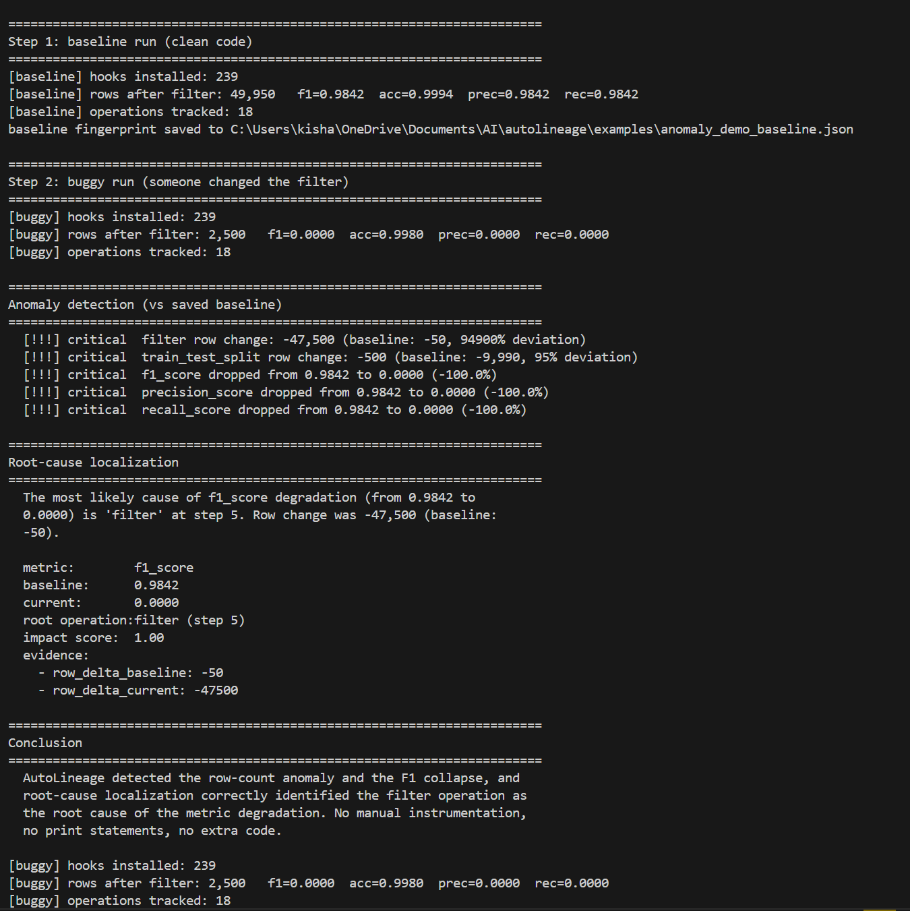

<h1 align="center">
  <picture>
    <source media="(prefers-color-scheme: dark)" srcset="https://raw.githubusercontent.com/kishanraj41/autolineage/main/docs/brand/autolineage-lockup-dark.svg">
    
  </picture>
</h1>

<p align="center"><b>Zero-code data lineage for Python ML pipelines.</b><br>
One import. Every pandas, scikit-learn and PySpark operation tracked, anomalies caught, root cause localized.</p>

<p align="center">
  <a href="https://pypi.org/project/autolineage/"></a>
  <a href="https://pypi.org/project/autolineage/"></a>
  <a href="https://github.com/kishanraj41/autolineage/actions/workflows/ci.yml"></a>
  <a href="https://github.com/kishanraj41/autolineage/blob/main/LICENSE"></a>
  <a href="https://papers.ssrn.com/sol3/papers.cfm?abstract_id=6683825"></a>
  <a href="https://colab.research.google.com/github/kishanraj41/autolineage/blob/main/examples/quickstart.ipynb"></a>
</p>

<p align="center"></p>

> **A pipeline can finish with no exception and still be wrong.** AutoLineage records the path from the load to the metric, then ranks the operations most likely to have caused the change. No decorators, no config.

```python
import autolineage.auto        # that's the whole setup

import pandas as pd
from sklearn.datasets import load_breast_cancer
from sklearn.model_selection import train_test_split
from sklearn.ensemble import RandomForestClassifier
from sklearn.metrics import f1_score

df = load_breast_cancer(as_frame=True).frame.dropna()
df = df[df["mean radius"] < 25]
X = df.drop(columns=["target"])
y = df["target"]
X_tr, X_te, y_tr, y_te = train_test_split(X, y, test_size=0.2, random_state=0)

model = RandomForestClassifier(n_estimators=100, random_state=0).fit(X_tr, y_tr)
preds = model.predict(X_te)
score = f1_score(y_te, preds)

# AutoLineage has tracked every line above into one DAG.
from autolineage.auto import get_tracker
get_tracker().visualize("trace.html", open_browser=False)
```

The same script is [`examples/pipeline.py`](examples/pipeline.py). It uses the public Wisconsin breast cancer dataset shipped with scikit-learn, so it runs without a data file.

**Try it in 30 seconds:** [open the quickstart in Colab](https://colab.research.google.com/github/kishanraj41/autolineage/blob/main/examples/quickstart.ipynb) (installs the package, tracks a pipeline, plants a bug, watches it get caught), or run the GIF above yourself:

```bash
pip install "autolineage[sklearn]"
git clone https://github.com/kishanraj41/autolineage && cd autolineage
python examples/anomaly_demo.py
```

**Install, run, inspect.** `pip install`, one import at the top of your script, then open the graph AutoLineage wrote:

<p align="center"></p>

The script in the recording is [`examples/pipeline.py`](https://github.com/kishanraj41/autolineage/blob/main/examples/pipeline.py). Click any node to see operation metadata, shape changes, and upstream dependencies. Export to JSON, Graphviz DOT, Mermaid markup, or self-contained HTML.

---

## Why AutoLineage?

ML pipelines fail silently. A metric can collapse while the script exits 0, and the usual next step is `print(df.shape)`. Experiment trackers need explicit logging (MLflow), data-version tools track files (DVC), and drift monitors cover one stage (Evidently, Arize). Research tools such as [mlinspect](https://github.com/stefan-grafberger/mlinspect) also patch pandas and scikit-learn, but inspect a single run against declared checks. AutoLineage's focus is the cross-run question: **between a good run and a bad one, which operation changed the data and the metric?**

AutoLineage closes that gap.

### Compared to other tools

| Capability | AutoLineage | MLflow | Evidently | OpenLineage | DataLineagePy |
|---|---|---|---|---|---|
| Zero code changes | **Yes** | No | No | No | No (wrapper) |
| Operation-level | **Yes** | No | No | Job-level | Yes |
| Cross-framework | **pandas + sklearn + PySpark** | — | — | Airflow, Spark, dbt, Flink (job-level) | pandas only |
| End-to-end trace | **Yes** | No | No | No | No |
| Anomaly detection | **Yes** | No | Drift only | No | No |
| Root-cause localization (ranked heuristic) | **Yes** | No | No | No | No |
| Interactive visualization | **Yes** | Web UI | Web UI | Web UI | No |

---

## Catching pipeline bugs automatically

This is what AutoLineage is for. Run `python examples/anomaly_demo.py` and watch a single-line filter bug get detected and localized:



The demo runs the same pipeline twice — once cleanly, once with a corrupted filter — and AutoLineage catches the row-count anomaly, the F1 collapse, and identifies the exact line that caused both. No manual instrumentation, no print statements.

Five checks compare a run with a saved baseline and exit non-zero on a failure, so CI can run them. Each one is taken from a documented incident. The pages are under `docs/checks/`. A sixth rule fails the run when a recorded metric drops more than 5% against the baseline.

```bash
autolineage baseline pipeline.py -o baseline.json
autolineage check pipeline.py --baseline baseline.json
```

Exit code 1 means a check failed. Exit code 2 means the script failed, the baseline could not be read, or the run recorded nothing to check.

---

## Installation

```bash
# Base install. pandas is installed with it. scikit-learn and PySpark
# are tracked when those packages are already installed.
pip install autolineage

# Recommended: include sklearn support (most common ML stack)
pip install autolineage[sklearn]

# OpenTelemetry span export
pip install autolineage[otel]

# Everything: sklearn + pyspark + Jupyter rich output + OpenTelemetry
pip install autolineage[all]
```

> AutoLineage detects which frameworks you have installed and hooks them automatically. The `sklearn` and `pyspark` extras tell pip to install those frameworks alongside AutoLineage if you don't have them already.

---

## Quick Start

### 1. Automatic tracking (one line)

```python
import autolineage.auto         # MUST be the first autolineage line in your script

# Use pandas / sklearn / pyspark normally — every operation is tracked
import pandas as pd
from sklearn.datasets import load_breast_cancer
df = load_breast_cancer(as_frame=True).frame.dropna().drop_duplicates()

from autolineage.auto import get_tracker
get_tracker().visualize("trace.html", open_browser=False)
```

> **Why first?** `import autolineage.auto` patches framework methods at import time. If your script or notebook does `from sklearn.metrics import f1_score` (or `from pandas import merge`, etc.) *before* this line, AutoLineage rebinds that name in `__main__` to the tracked version and warns you that it did. Names imported early inside *other* modules can't be rebound and still bypass tracking, so putting `import autolineage.auto` at the top remains the clean fix. Set `AUTOLINEAGE_REBIND_EARLY_IMPORTS=0` to keep early imports untouched. Set `AUTOLINEAGE_SOURCE_STAMP=0` to keep the caller's file, line, and filter expression out of records and fingerprints.

### 2. Visualize the lineage

```python
tracker = get_tracker()

tracker.visualize()                          # interactive HTML, opens in browser
tracker.visualize("trace.html")              # custom path, no browser pop-up
tracker.to_dot()                             # Graphviz DOT
tracker.to_mermaid()                         # Markdown-friendly Mermaid
```

In Jupyter notebooks, putting the tracker as the last expression in a cell auto-renders a summary table:

```python
get_tracker()  # in a Jupyter cell — produces a rich HTML table inline
```

### 3. Anomaly detection

```python
from autolineage.core.analyzer import LineageAnalyzer

analyzer = LineageAnalyzer(tracker)
analyzer.load_baseline("baseline.json")        # compare against a saved healthy run
anomalies = analyzer.detect_anomalies()

for a in anomalies:
    print(f"[{a.severity}] {a.message}")
# [critical] filter row change: -47,500 (baseline: -50, 94900% deviation)
# [critical] f1_score dropped from 0.9842 to 0.0000 (-100.0%)
```

### 4. Root-cause localization

```python
cause = analyzer.localize_root_cause("f1_score")
print(cause.explanation)
# "The most likely cause of f1_score degradation (from 0.9842 to 0.0000)
#  is 'filter' at step 5. Row change was -47,500 (baseline: -50)."
```

### 5. Save a fingerprint for future comparison

```python
analyzer.save_fingerprint("baseline.json")     # after a healthy run

# Next run, in a different process:
analyzer = LineageAnalyzer(new_tracker)
analyzer.load_baseline("baseline.json")
anomalies = analyzer.detect_anomalies()
```

### 6. Export to OpenTelemetry (optional)

```python
from autolineage.otel import enable_otel_export

exporter = enable_otel_export()      # uses your global OpenTelemetry tracer provider
# ... pipeline runs ...
exporter.shutdown()
```

Every tracked operation becomes a span (`pandas-transforms.merge`, `sklearn.f1_score`, ...) under one `autolineage.run` span, timed by its measured duration, with rows before/after, shapes, columns added/removed, and metric values as attributes. Spans go wherever your tracer provider already sends them (OTLP collector, Jaeger, Tempo, Honeycomb); AutoLineage configures no exporter of its own. Lineage IDs (`autolineage.child_id`, `autolineage.parent_ids`) are attributes, so traces from separate processes can be joined on them. Requires `pip install autolineage[otel]`.

---

## What Gets Tracked

**pandas-io (10 hooks):** `read_csv`, `to_csv`, `read_parquet`, `to_parquet`, and the other readers and writers.

**pandas-transforms (60 hooks):** `dropna`, `fillna`, `merge`, `concat`, `get_dummies`, `to_datetime`, `to_numeric`, `Series.astype`, `groupby` aggregations, `drop_duplicates`, boolean filtering, `assign`, `sort_values`, `pivot_table`, `melt`, and the other frame methods in `autolineage/hooks/pandas_transform.py`.

**scikit-learn (235 hooks):** `train_test_split`, estimator `fit` / `predict` / `predict_proba` / `score`, preprocessor methods, `CountVectorizer` and `TfidfVectorizer`, metric functions, and construction of each hooked class.

**PySpark (49 hooks):** DataFrame transforms, `groupBy` aggregations, join variants, reader and writer methods, and actions. Counted with PySpark 4.3.0 installed.

See [`autolineage/hooks/`](autolineage/hooks/) for the full list.

---

## Architecture

Plugin-based. Each library is a single file implementing `BaseHookProvider`. Adding new libraries requires ~200 lines and zero changes to the core.

```
   User Code (unchanged)
           |
   Hook Providers (pandas | sklearn | pyspark | ...)
           |
   UnifiedTracker + TransformationRecord
           |
   LineageAnalyzer  →  anomalies, root causes, fingerprints
   Visualizer       →  HTML / DOT / Mermaid / Jupyter
```

---

## Real pipelines

The held-out study of third-party scripts is in [`benchmarks/real/`](benchmarks/real/). Its protocol was frozen before scoring. Two faults were scoreable. Coverage of pipeline-call lines on that re-score was 0.29.

---

## Limitations

- **One machine.** A child started with `multiprocessing` or `multiprocess` after tracking is on sends its records to the parent tracker when the child is joined. With `autolineage[otel]`, every process can export spans carrying lineage IDs to one backend; joining those into a cross-machine graph is still up to you.
- **Threads.** Calls your code makes on its own threads are recorded. Calls a library makes on its own worker threads (the trees of a forest fitted with `n_jobs`) are treated as internal and are not recorded.
- **Monkey-patching is version-sensitive.** Tested against pandas 2.x / 3.x, scikit-learn 1.x, PySpark 3.x / 4.x.
- **Import order matters outside `__main__`.** A hooked function imported by name *before* the hooks are installed is rebound automatically in your script or notebook, but not inside other modules you import (a helper module that does `from sklearn.metrics import f1_score` first keeps the untracked reference). Put `import autolineage.auto` first to avoid both cases.
- **C-extension code is invisible.** Operations that execute entirely in compiled code without re-entering Python (e.g., certain numpy reductions) are not captured.
- **Python-only.** R, Julia, Java are out of scope.

---

## Documentation

- [Quickstart](docs/quickstart.md)
- [API reference](docs/api.md)
- [Changelog](CHANGELOG.md)

Project history: first tagged 2026-01-27 (`v0.1.0-day1`) and first released on PyPI on 2026-02-17 (0.1.0). `main` was reinitialised on 2026-04-19 at v0.3.0 to adopt the plugin architecture; the earlier tags are kept in the repository.

---

## Contributing

Add a new library in 5 steps:

1. Create `autolineage/hooks/your_lib_hooks.py`
2. Subclass `BaseHookProvider`
3. Implement `install(tracker)` and `uninstall()`
4. Register in `autolineage/hooks/registry.py`
5. Open a PR

See `autolineage/hooks/pandas_io.py` for the smallest working example (~110 LoC).

---

## Development

```bash
git clone https://github.com/kishanraj41/autolineage
cd autolineage
pip install -e ".[dev]"
pytest tests/                      # some OpenTelemetry tests skip without the otel extra
python examples/anomaly_demo.py    # full end-to-end demo
```

---

## License

MIT

---

## Citation

If you use AutoLineage in your research or work, please cite the SSRN preprint:

**Plain citation:**

> VG, K.R. (2026). *AutoLineage: Operation-Level Data Lineage for Python ML Pipelines via Import-Time Hooking*. SSRN preprint. https://papers.ssrn.com/sol3/papers.cfm?abstract_id=6683825

**BibTeX:**

```bibtex
@misc{vg2026autolineage,
  title  = {AutoLineage: Operation-Level Data Lineage for Python ML Pipelines via Import-Time Hooking},
  author = {VG, Kishan Raj},
  year   = {2026},
  note   = {SSRN preprint, abstract\_id=6683825},
  url    = {https://papers.ssrn.com/sol3/papers.cfm?abstract_id=6683825}
}
```
